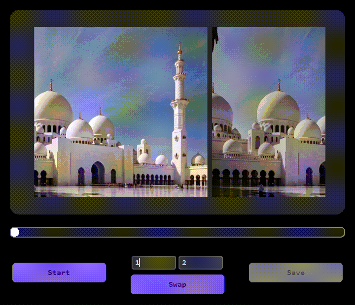
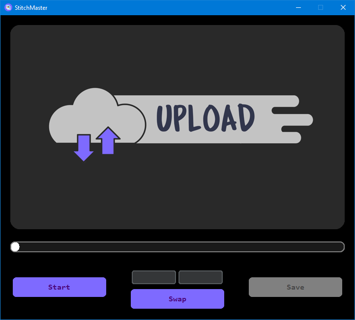

# Ghép ảnh toàn cảnh (Panorama) dựa trên đặc trưng SIFT và thuật toán RANSAC

> **Panorama Image Stitching using SIFT Features and RANSAC-based Homography Estimation**

Repo ghép nhiều ảnh chụp liên tiếp (có phần chồng lấn) thành **một ảnh toàn cảnh**. **Toàn bộ thuật toán được viết từ đầu bằng NumPy**: SIFT, so khớp đặc trưng, RANSAC, Homography (DLT), uốn ảnh (warp), trộn ảnh và cắt viền. **Không dùng hàm xử lý ảnh có sẵn** của OpenCV, scikit-image hay scikit-learn. OpenCV chỉ dùng để **đọc/ghi file ảnh** và để **đối chiếu kết quả** trong file test.

Ý tưởng ghép dựa trên bài báo *"The Improved Algorithm of Fast Panorama Stitching for Image Sequence and Reducing the Distortion Errors"* ([link](https://www.researchgate.net/publication/282435745_The_Improved_Algorithm_of_Fast_Panorama_Stitching_for_Image_Sequence_and_Reducing_the_Distortion_Errors)): thay vì ghép lần lượt từ ảnh đầu tiên, thuật toán **lấy ảnh ở giữa làm ảnh tham chiếu** rồi ghép lan dần sang hai bên, giúp **giảm méo hình tích lũy**.

<p align="center"></p>

---

## 1. Cấu trúc thư mục

```
SIFT-Image-Stitching-main/
├── python/
│   ├── image_ops.py              # ★ Các phép xử lý ảnh TỰ VIẾT (thay toàn bộ OpenCV/skimage/sklearn)
│   ├── sift_extractor.py         # Lớp SIFT: keypoint + descriptor 128 chiều
│   ├── panorama_stitching.py     # Lớp Panorama: so khớp, RANSAC, ghép nhiều ảnh, cắt viền
│   ├── general_functions.py      # Hàm phụ: chuẩn hóa, Sobel/histogram (bản vòng lặp + bản nhanh)
│   ├── run_panorama.py           # Chạy ghép ảnh bằng dòng lệnh
│   ├── gui.py                    # Giao diện "StitchMaster" (CustomTkinter)
│   └── dark-blue.json            # Màu sắc giao diện
├── tests/
│   └── compare_with_opencv.py    # So sánh từng hàm tự viết với OpenCV + 3 test cases ghép ảnh
├── SIFT_implementation.ipynb             # Notebook 1: minh họa từng bước SIFT
├── RANSAC_Homography_Stitching.ipynb     # Notebook 2: ghép 2 ảnh
├── Panorama_Stitching.ipynb              # Notebook 3: ghép 8 ảnh
├── images/                       # Ảnh thử nghiệm
├── results/                      # Ảnh kết quả của test (tự sinh khi chạy)
└── _backup_goc/                  # Bản gốc của repo trước khi viết lại (để đối chiếu)
```

---

## 2. Quy trình hoạt động của hệ thống

```
 Ảnh 1, Ảnh 2, ..., Ảnh N  (ảnh màu, đã sắp xếp từ trái sang phải)
            │
            ▼
 [0] Thu nhỏ ảnh rộng hơn 800 px (cho nhanh)            resize_bilinear
 [1] Chuyển sang ảnh xám, giá trị trong [0, 1]           rgb2gray
            │
            ▼
 [2] SIFT cho từng ảnh                                    sift_extractor.py
      ├─ Làm mờ Gaussian 6 mức sigma                      gaussian_blur
      ├─ DoG: trừ 2 ảnh mờ liền kề
      ├─ Cực trị trong lân cận 3x3x3 (26 điểm)
      ├─ Loại điểm nằm trên cạnh (tỉ lệ Hessian)          sobel
      ├─ Gán hướng chính (histogram 36 bin)               cart_to_polar
      └─ Descriptor 128 chiều (4x4 ô x 8 hướng)           rotate, get_hist_fast
            │
            ▼
 [3] Với mỗi cặp ảnh liền kề (i, i+1):
      ├─ So khớp láng giềng gần nhất + ratio test         match_descriptors
      └─ RANSAC + DLT → ma trận Homography H (3x3)         ransac_homography
            │
            ▼
 [4] Ghép ảnh bắt đầu từ ẢNH GIỮA
      ├─ Ảnh bên trái : nhân dồn H ;  bên phải : nhân dồn H⁻¹
      ├─ Uốn ảnh về hệ tọa độ ảnh giữa                    warp_perspective
      └─ Vùng chồng lấn: lấy trung bình 2 ảnh
            │
            ▼
 [5] Cắt bỏ viền đen                                      binary_closing, largest_component
            │
            ▼
       ẢNH PANORAMA
```

### Giải thích lý thuyết từng bước

| Bước | Làm gì | Tại sao |
|---|---|---|
| **Gaussian + DoG** | Làm mờ ảnh nhiều mức rồi trừ nhau | Làm nổi bật đốm và góc ở nhiều kích thước, nên **bất biến tỉ lệ** |
| **Cực trị 3×3×3** | Điểm lớn nhất/nhỏ nhất so với 26 lân cận | Điểm "đặc biệt", dễ tìm lại ở ảnh khác |
| **Lọc Hessian** | Giữ điểm có `Tr(H)²/Det(H) < (r+1)²/r` | Điểm trên cạnh không ổn định khi so khớp |
| **Hướng chính** | Hướng gradient mạnh nhất quanh điểm | Xoay descriptor theo hướng này nên **bất biến phép xoay** |
| **Descriptor 128D** | Histogram hướng gradient trên 16 ô | "Dấu vân tay" của điểm, chuẩn hóa nên ít bị ảnh hưởng bởi độ sáng |
| **So khớp + ratio test** | Điểm gần nhất, và gần hơn hẳn điểm gần nhì (< 0.8 lần) | Loại các cặp mập mờ |
| **RANSAC** | Lặp: chọn ngẫu nhiên 4 cặp → giải H → đếm inlier (sai số < 5 px) | Loại cặp khớp sai (outlier) |
| **DLT** | Mỗi cặp điểm cho 2 phương trình; giải `A·h = 0` bằng SVD | Tìm H từ ≥ 4 cặp điểm |
| **Homography** | `[x', y', w]ᵀ = H · [x, y, 1]ᵀ` | Mô tả phép xoay/kéo/nghiêng để chồng ảnh này lên ảnh kia |
| **Warp (ánh xạ ngược)** | Mỗi pixel đích lấy màu từ điểm `H⁻¹·p` (nội suy song tuyến) | Ảnh đích không bị "lỗ" |
| **Ghép từ ảnh giữa** | Ảnh tham chiếu ở giữa, lan ra 2 bên | Sai số không dồn hết về một đầu |

---

## 3. Thư viện sử dụng

| Thư viện | Dùng để | Có phải hàm xử lý ảnh có sẵn? |
|---|---|---|
| `numpy` | Toàn bộ thuật toán (mảng, SVD, nghịch đảo ma trận) | Không – được phép |
| `opencv-python` | **Chỉ** `imdecode`/`imencode` để đọc/ghi file, và làm đáp án trong `tests/` | Được phép (đọc/ghi) |
| `pandas` | Lưu bảng keypoint/descriptor | Không |
| `matplotlib` | Vẽ hình trong notebook | Không |
| `Pillow`, `customtkinter` | Hiển thị ảnh trên giao diện | Không |
| `numba` *(tùy chọn)* | Tăng tốc vài hàm vòng lặp minh họa; không cài vẫn chạy | Không |

### Cài đặt

```bash
pip install numpy opencv-python pandas matplotlib pillow customtkinter jupyter
```

---

## 4. Cách chạy

### 4.1. Giao diện (demo)

```bash
python python/gui.py
```

<p align="center"></p>

1. **Bấm vào khung ảnh** để chọn nhiều ảnh, theo thứ tự **từ trái sang phải**.
2. Nếu sai thứ tự: nhập 2 số thứ tự (bắt đầu từ 1) vào 2 ô rồi bấm **Swap**.
3. Bấm **Start**, đợi thanh tiến trình chạy xong.
4. Bấm **Save**: ảnh được lưu vào `results/panorama_img1.png`, `panorama_img2.png`, …

### 4.2. Dòng lệnh

```bash
python python/run_panorama.py images/test1.png images/test2.png images/test3.png -o results/ketqua.png
python python/run_panorama.py images/mosque1.jpg images/mosque2.jpg -o results/mosque.png
```

Tùy chọn `--max-width 0` để không thu nhỏ ảnh (chậm hơn).

### 4.3. Test cases và so sánh với OpenCV

```bash
python tests/compare_with_opencv.py
```

### 4.4. Notebook (để thuyết trình)

```bash
jupyter notebook
```

Mở ở **thư mục gốc repo**, theo thứ tự Notebook 1 → 2 → 3. Notebook đã được viết lại để gọi code tự viết trong `python/`.

---

## 5. Kết quả thử nghiệm

Chạy `tests/compare_with_opencv.py` trên máy thử (CPU 2 nhân):

**Phần 1: so sánh từng hàm tự viết với hàm của OpenCV** (ảnh `img3.jpg`, thang giá trị [0, 1])

| Phép toán | Sai số lớn nhất | Sai số trung bình | Nhận xét |
|---|---|---|---|
| Gaussian blur | 8.9e-16 | 9.1e-17 | Trùng khớp (chỉ sai số làm tròn số thực) |
| Resize song tuyến | 2.2e-13 | 4.6e-15 | Trùng khớp |
| Sobel x / y | 6.7e-16 | 5.8e-17 | Trùng khớp |
| Warp perspective | 0.87 | 2.0e-4 | Chỉ khác ở vài pixel sát mép vùng ảnh |
| RANSAC homography | 0.23 px | 0.07 px | Cùng 140/200 inlier như OpenCV |

Code tự viết chậm hơn OpenCV khoảng 5–15 lần, vì OpenCV viết bằng C++ có tối ưu SIMD.

**Phần 2: test cases ghép ảnh** (ảnh kết quả trong `results/`, kèm bản `*_opencv.png` của `cv2.Stitcher` để so sánh)

| Test case | Thời gian | Kích thước kết quả | Inlier / cặp khớp |
|---|---|---|---|
| 8 ảnh `test1`–`test8` | ~15 s | 2195×525 | 60/70, 110/133, 130/149, 57/69, 38/49, 42/52, 94/102 |
| 2 ảnh `mosque1` + `mosque2` | ~3 s | 962×768 | 297/322 |
| 3 ảnh cắt từ `img.jpg` (ảnh giữa xoay 5°) | ~4 s | 1363×764 | 171/241, 101/176 |

---

## 6. Giải thích các file code

### `python/image_ops.py`: các phép xử lý ảnh tự viết

| Hàm tự viết | Thay cho | Ý tưởng chính |
|---|---|---|
| `rgb2gray` | `skimage.rgb2gray` | `0.2125R + 0.7154G + 0.0721B` |
| `correlate2d` | `cv2.filter2D` | Cộng dồn các ảnh dịch chuyển nhân với hệ số của kernel |
| `gaussian_kernel_1d`, `gaussian_blur` | `cv2.GaussianBlur` | Kernel Gaussian tách được → lọc theo hàng rồi theo cột |
| `sobel`, `cart_to_polar` | `cv2.Sobel`, `cv2.cartToPolar` | Kernel 3×3; độ lớn = √(gx²+gy²), góc = atan2 |
| `bilinear_sample` | (nội bộ OpenCV) | Nội suy từ 4 pixel lân cận |
| `resize_bilinear` | `cv2.resize` | Ánh xạ tâm pixel + nội suy song tuyến |
| `rotate` | `skimage.rotate` | Ánh xạ ngược qua ma trận xoay quanh tâm |
| `apply_homography` | `cv2.perspectiveTransform` | Tọa độ thuần nhất, chia cho w |
| `compute_homography_dlt` | (lõi của `findHomography`) | Chuẩn hóa Hartley + SVD |
| `ransac_homography` | `cv2.findHomography(RANSAC)` | 4 điểm ngẫu nhiên, đếm inlier, số vòng lặp thích nghi |
| `warp_perspective` | `cv2.warpPerspective` | Ánh xạ ngược `H⁻¹`, xử lý theo khối hàng |
| `match_descriptors` | `sklearn NearestNeighbors` | Ma trận khoảng cách Euclid + ratio test |
| `binary_dilate/erode/closing` | `cv2.morphologyEx` | Lọc max/min cửa sổ vuông |
| `largest_component` | `cv2.findContours` + `boundingRect` | Gán nhãn liên thông bằng lan truyền nhãn nhỏ nhất |

### `python/sift_extractor.py`: lớp `SIFT`

| Hàm | Chức năng |
|---|---|
| `__init__` | Tham số: `sigma=1.2`, `k=√1.8`, `num_downsamples`, `doG_thresh=0.003`, `r=10` |
| `downsample_img` | B1: tạo các octave |
| `create_octave` | B2: làm mờ Gaussian với 6 mức sigma |
| `get_doG` | B3: 5 ảnh Difference of Gaussians |
| `get_keypoints` | B4: cực trị 3×3×3 + ngưỡng tương phản (vector hóa) |
| `filter_keypoints` | B5: loại điểm trên cạnh bằng tỉ lệ Hessian |
| `get_dominant_angles` | B6: histogram 36 bin → hướng chính + hướng phụ (≥ 80% đỉnh) |
| `get_descriptor` | B7: vùng 16×16 xoay theo hướng chính → 128 chiều, chuẩn hóa |
| `extract_sift_data` | **Hàm chính**: trả về `DataFrame` gồm `Position`, `Size`, `Orientation`, `Descriptor` |

### `python/panorama_stitching.py`: lớp `Panorama`

| Hàm | Chức năng |
|---|---|
| `get_panorama` | **Hàm chính**: thu nhỏ → ảnh xám → SIFT → homography → ghép → cắt viền |
| `get_sift_descriptors` | SIFT cho mọi ảnh (1 octave cho nhanh) |
| `compute_affine_matrices` | H giữa mọi cặp ảnh liền kề |
| `compute_homography_matrix` | So khớp + RANSAC → H; lưu số cặp khớp/inlier vào `match_info` |
| `stitch_multiple_images` | Ghép từ ảnh giữa, nhân dồn H (trái) và H⁻¹ (phải) |
| `stitch_backward` | Uốn 1 ảnh theo H tích lũy rồi ghép vào ảnh hiện có |
| `stitch_two_images` | Chồng 2 ảnh: vùng chồng lấn lấy trung bình, bỏ dải mép tối 2 px |
| `find_bounding_box` | Phân ngưỡng → closing → vùng liên thông lớn nhất → thu hẹp tới khi hết viền đen |

### Các file khác

- **`general_functions.py`**: `get_hist` là bản vòng lặp dễ đọc để giải thích; `get_hist_fast` là bản vector hóa cho **cùng kết quả** (sai lệch ~1e-13), được SIFT dùng để chạy nhanh.
- **`run_panorama.py`**: đọc/ghi ảnh (hỗ trợ đường dẫn có dấu tiếng Việt) và chạy ghép từ dòng lệnh.
- **`gui.py`**: giao diện; thuật toán chạy trong **luồng riêng** để giao diện không bị treo; báo lỗi nếu 2 ảnh không ghép được.

---

## 7. Những thay đổi so với repo gốc

| Nội dung | Repo gốc | Bản hiện tại |
|---|---|---|
| Hàm xử lý ảnh | Dùng `cv2.GaussianBlur`, `Sobel`, `resize`, `findHomography`, `warpPerspective`, `findContours`, skimage, sklearn | **Tự viết toàn bộ** trong `image_ops.py` |
| Tìm keypoint | Mọi vòng lặp đều dùng 3 DoG đầu tiên (trùng lặp kết quả) | Dùng đúng bộ DoG `i-1, i, i+1` |
| Điều kiện cực trị | Cho phép "lớn hơn DoG trên/dưới" kết hợp với "nhỏ nhất trong DoG giữa" | Cực đại phải là max ở cả 3 DoG, cực tiểu là min ở cả 3 (đúng SIFT) |
| Hướng phụ | So sánh nhầm với **góc** của hướng chính | So với **80% giá trị đỉnh** histogram (đúng bài báo Lowe) |
| So khớp | Chỉ ngưỡng khoảng cách | Thêm **ratio test** của Lowe (tự tắt nếu còn quá ít cặp) |
| Ghép số ảnh lẻ | Với 3 ảnh, ảnh thứ 3 bị bỏ sót | Ghép đủ mọi ảnh |
| Trộn ảnh | Vệt kẻ tối ở mép mỗi ảnh | Bỏ dải mép 2 px khi lấy trung bình |
| Tốc độ | Cần numba | Vector hóa NumPy, không cần numba; ảnh lớn tự thu nhỏ còn 800 px |
| Chạy GUI | Phải đứng đúng thư mục, chỉ chạy trên Windows | Chạy từ đâu cũng được, mọi hệ điều hành |

---

## 8. Hạn chế

- **Ảnh phải được sắp xếp đúng thứ tự** từ trái sang phải, và 2 ảnh liền kề phải **chồng lấn** đủ nhiều (khoảng 30% trở lên).
- **Blending đơn giản** (lấy trung bình), nên có thể thấy "bóng ma" khi vật chuyển động hoặc khi căn chỉnh lệch vài pixel. Muốn đẹp hơn có thể dùng feathering hoặc multi-band blending.
- Panorama có thể **bị nghiêng** nếu ảnh tham chiếu (ảnh giữa) bị nghiêng, vì các ảnh khác được đưa về hệ tọa độ của nó.
- Chỉ dùng homography phẳng, chưa chiếu lên mặt trụ (cylindrical warping), nên với panorama rất rộng (> 120°) hai đầu sẽ bị kéo giãn.
- So với SIFT đầy đủ của Lowe, bản này vẫn **đơn giản hóa** vài chỗ: không nội suy vị trí keypoint dưới mức pixel, ma trận lọc cạnh dùng tổng bình phương trên vùng 5×5 (theo repo gốc), descriptor tính trên ảnh DoG.
- Kém bền khi ánh sáng giữa các ảnh khác nhau nhiều.

---

## 9. Tài liệu tham khảo

1. D. G. Lowe, *"Distinctive Image Features from Scale-Invariant Keypoints"*, IJCV, 2004.
2. M. Brown, D. G. Lowe, *"Automatic Panoramic Image Stitching using Invariant Features"*, IJCV, 2007.
3. *"The Improved Algorithm of Fast Panorama Stitching for Image Sequence and Reducing the Distortion Errors"*: bài báo gốc mà repo dựa theo.
4. M. A. Fischler, R. C. Bolles, *"Random Sample Consensus"*, Communications of the ACM, 1981.
5. R. Hartley, A. Zisserman, *Multiple View Geometry in Computer Vision*, 2003: DLT và chuẩn hóa điểm.
